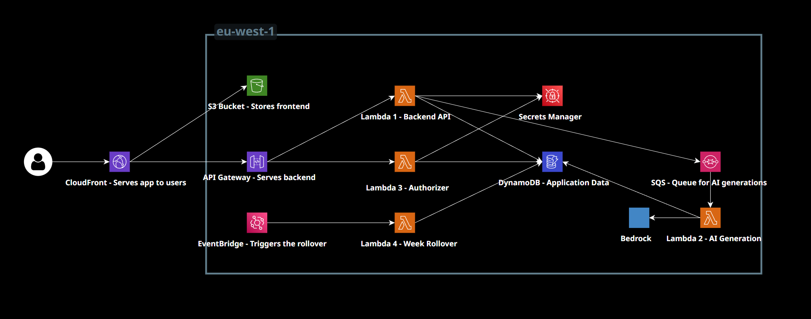

# Planificador semanal colaborativo de comidas

Proyecto final del curso de AWS (opción libre). Aplicación web, con
infraestructura en AWS y backend en Python.

Antes que nada: El desarrollo de este proyecto final ha sido complicado. Ni que decir tiene que he tardado más de lo esperado, principalmente debido a que quería hacer un proyecto final que, además de para aplicar mis conocimientos, sirviera para mi día a día. El resultado ha sido una aplicación con la que, no voy a mentir, no estoy del todo contento (aunque, por supuesto, me esforzaré para mejorarla). Sí creo que la arquitectura en AWS está correcta y principalmente hace lo que tenía pensado que hiciera, pero quizá he querido abarcar demasiado para lo que debería ser un proyecto de este tipo, y con demasiadas cosas nuevas para mí (también ha sido mi primera vez en un desarrollo con un workflow agéntico completo, y creo que también he pecado de tener un flujo de agentes demasiado complejo para una aplicación de estas dimensiones). 

Todo esto, en sí, también es una lección, además de todas las que me he llevado durante el curso.

## Descripción funcional

Un conjunto cerrado de usuarios, gestionado por un administrador, planifica entre
todos las comidas de la **semana actual y la siguiente** (de lunes a domingo,
comida y cena).

- **Roles**: Admin (vista exclusiva de gestión de usuarios: alta, cambio de nombre,
  restablecimiento de contraseña) y Usuario (toda la planificación). No hay registro
  público; el login es usuario + contraseña y las contraseñas asignadas son
  temporales (se fuerza un cambio en el primer acceso).
- **Planificación**: cada franja admite propuestas de comida candidatas y una
  comida definitiva elegida entre todos.
- **Biblioteca de recetas** compartida.
- **IA generativa** (Amazon Bedrock): generación de recetas y de planes de semana
  completa bajo reglas compartidas, de forma asíncrona (cola SQS).
- **Lista de la compra** única y compartida, con elementos marcables al comprarlos.
- **Archivo** de semanas pasadas; un proceso programado archiva la semana cada
  domingo por la noche (hora de Madrid).
- Cambios entre usuarios reflejados casi en tiempo real. Interfaz adaptable a
  escritorio y móvil.

El detalle funcional está en `docs/requirements.md` y `docs/app_user_stories.md`.

## Decisión arquitectónica

Generalmente se optará por recursos serverless, ya que se espera que el MVP sea utilizado principalmente por 2 personas, por lo que para minimizar el coste a la vez que se asegura la escalabilidad en caso de decidir abrirlo a más usuarios, será importante el pago por uso y la capacidad de escalar cualquier recurso a 0 cuando no se use. Por la naturaleza de la aplicación, el tráfico esperado será por el día y esporádico, para consultar y actualizar el menú semanal o la lista de la compra.

- Para el frontend, se ha optado por una single page app, aumentando así la dependencia del backend para mostrar la aplicación pero simplificando considerablemente el desarrollo frontend, en el cual tengo mucha menos experiencia. En AWS se utiliza, al ser una página estática, un recurso CloudFront con el sitio alojado en un bucket S3, por ser una solución sencilla y escalable que asegura siempre un servidor cercano a cualquier usuario en las edge locations.

- Para la base de datos, como opción serverless, se opta por DynamoDB, que ofrece rapidez y escalabilidad con el modelo de pago por uso. Se ha adaptado el modelo de datos para este tipo de base de datos desde su creación, siendo un modelo de tabla única que se puede consultar en su documentación correspondiente.

- La gestión de usuarios se realiza en el backend con la base de datos DynamoDB como respaldo.

- En cuanto al backend, siguiendo con la filosofía serverless del proyecto, se utilizan funciones Lambda. Esto facilita el escalado y permite enfocar el funcionamiento de la app para que sea orientado a eventos. Se utilizan cuatro funciones Lambda: una que expone los endpoints necesarios para que el frontend realice operaciones, otra que se ocupa de las operaciones de IA en forma de workers activadas por una cola, otra cuya función es comprobar si el usuario que realiza una llamada tiene una sesión válida y una última que se ocupa del cambio de semana, activada por EventBridge. De esta forma se separan funciones y no hay una única Lambda ocupándose de toda la funcionalidad de la aplicación.

- Para hacer las operaciones de generación con IA asíncronas, se usa cola estándar porque no se requiere orden; al garantizar entrega al menos una vez, el worker reclama cada solicitud mediante una clave de idempotencia, de modo que un mensaje duplicado no genera una segunda generación

- Para exponer el backend al frontend se utiliza API Gateway como única puerta de entrada HTTP, que aporta además TLS y la posibilidad de limitar el ritmo de peticiones, sin infraestructura que mantener y con pago por uso.

- La generación de recetas y de menús semanales se delega en Amazon Bedrock, buscando un modelo potente para aportar lógica a los resultados pero a su vez suficientemente ligero y rápido para que los tiempos de generación sean razonables.

- En cuanto a observabilidad, cada Lambda escribe registros estructurados en JSON en su propio grupo de CloudWatch Logs y cada invocación deja un registro con el método, el recurso y el estado. Dos tipos de alarma notifican por correo mediante un tema SNS: la aparición de mensajes en la DLQ de la generación con IA, y cualquier error en cada una de las Lambdas. De este modo un fallo se detecta sin tener que revisar los registros manualmente.

- Para control de costes, dos presupuestos de AWS vigilan el gasto: uno mensual en la cuenta principal, que abarca todo el gasto de esa cuenta y no incluye Bedrock, y otro específico para Bedrock, que avisa por correo al 80 % y bloquea las invocaciones al modelo al 100 %. Al actualizarse AWS Budgets hasta tres veces al día, el bloqueo no es inmediato.



## Instrucciones reproducibles de despliegue

Se despliega un entorno por vez (`dev` por defecto). Terraform crea la
infraestructura (con Lambdas vacías de relleno) y el pipeline de GitHub Actions
sube después el código del backend y del frontend.

### 1. Requisitos previos

| Herramienta | Versión | Para qué |
|---|---|---|
| Terraform | >= 1.10 y < 2.0 | Infraestructura (`terraform/providers.tf`) |
| AWS CLI v2 | reciente | Perfiles, comprobaciones y teardown |
| uv | 0.11.x (la de CI es 0.11.7) | CLI de alta del Admin; usa Python 3.13 (`backend/.python-version`) |
| Git y GitHub CLI (`gh`) | reciente | Disparar el pipeline |
| Node.js + npm | solo para desarrollo local | No hace falta para desplegar: lo compila CI |

Cuentas y credenciales:

- **Cuenta principal de AWS** (aplicación) con un perfil de CLI. Debe existir ya el
  rol IAM de ejecución de las Lambdas (`studentLambdaExecutionRole` por defecto,
  variable `lambda_execution_role_name`).
- **Cuenta de AWS separada con Bedrock** (gasto y acceso al modelo) con otro perfil.
  Ambas cuentas usan la región fijada en `terraform/locals.tf`.
  Comprobar en la consola de Bedrock de esa cuenta que el modelo indicado en la
  variable `ai_model_id` está disponible y habilitado en la región una vez desplegado el
  recurso con Terraform.
- **Bucket S3 para el estado de Terraform**. El repositorio **no** lo crea (no hay
  bootstrap): hay que crearlo antes a mano, cifrado, en la región fijada en `terraform/locals.tf`.
- Un usuario IAM con claves de acceso (o credenciales temporales) para que
  GitHub Actions despliegue las Lambdas y el frontend.

```bash
aws login --profile <perfil-principal>    # o `aws configure --profile ...`
aws login --profile <perfil-bedrock>
aws sts get-caller-identity --profile <perfil-principal>   # anotar <ID-CUENTA>
```

### 2. Configurar Terraform

1. Crear el bucket de estado (si no existe) y activar el versionado. El bucket se
   crea en el espacio de nombres regional de la cuenta, cuyo nombre debe seguir el
   formato `<prefijo>-<ID-CUENTA>-eu-west-1-an` (la opción `--bucket-namespace`
   requiere una AWS CLI reciente):

   ```bash
   ACCOUNT_ID=$(aws sts get-caller-identity --query Account --output text --profile <perfil-principal>)
   BUCKET="lab-final-terraform-<sufijo>-${ACCOUNT_ID}-eu-west-1-an"
   aws s3api create-bucket --bucket "$BUCKET" --bucket-namespace account-regional \
     --region eu-west-1 --create-bucket-configuration LocationConstraint=eu-west-1 \
     --profile <perfil-principal>
   aws s3api put-bucket-versioning --bucket "$BUCKET" \
     --versioning-configuration Status=Enabled --profile <perfil-principal>
   ```

2. Editar el bloque `backend "s3"` de `terraform/providers.tf`: los campos
   `profile` y `bucket` están fijados al entorno del autor del proyecto y no admiten
   variables. Poner el perfil correspondiente y el nombre del bucket a utilizar (el actual sigue el
   patrón `lab-final-terraform-<sufijo>-<ID-CUENTA>-eu-west-1-an`). La clave de estado
   (`terraform-lab/terraform.tfstate`) y `use_lockfile` se mantienen.

3. Crear `terraform/terraform.tfvars` (ignorado por git) a partir del ejemplo:

   ```bash
   cd terraform
   cp terraform.tfvars.example terraform.tfvars
   ```

   Contenido mínimo; `alert_email` es la única variable sin valor por defecto, pero
   los perfiles y el prefijo por defecto son los del autor, por lo que deben sobrescribirse:

   ```hcl
   alert_email         = "correo@ejemplo.com"
   aws_profile         = "<perfil-principal>"
   bedrock_aws_profile = "<perfil-bedrock>"
   project_name        = "lab-final-<sufijo>"   # prefijo de todos los recursos
   environment         = "dev"                   # dev | stg | prod
   ```

   El nombre del bucket del frontend es `<project_name>-<environment>-frontend-<ID-CUENTA>-eu-west-1-an`
   y debe caber en 63 caracteres. Otras variables opcionales (`monthly_budget_usd`=60,
   `ai_budget_usd`=50, `log_retention_days`=14, `ai_generation_enabled`=true,
   `cloudfront_price_class`, límites de throttling, etc.) están descritas en
   `terraform/variables.tf`.

### 3. Aplicar la infraestructura

```bash
cd terraform
terraform init
terraform plan -out=tfplan
terraform apply tfplan
```

Hasta el paso 5 las Lambdas contienen un código de relleno que falla al invocarse.
Tras el `apply`, AWS envía un correo de confirmación de suscripción SNS (alarmas) y
otro de Budgets a `alert_email`: confirmar la suscripción SNS.

Anotar las salidas que usará el pipeline:

```bash
terraform output -raw app_url
terraform output -raw frontend_bucket
terraform output -raw cloudfront_distribution_id
terraform output -json lambda_function_names
```

### 4. Configurar GitHub Actions

El workflow `Deploy` (`.github/workflows/deploy.yml`) despliega por rama:
`dev` -> entorno `dev`, `staging` -> `staging`, `main` -> `production`. Antes pasa
los tests y compila los paquetes una sola vez. Terraform **no** lo ejecuta el
pipeline: es manual (apartado 3). Los entornos de GitHub se llaman `dev`, `staging`
y `production` (no `stg`/`prod` como en Terraform).

En el repositorio de GitHub, crear el entorno (Settings > Environments) y definir:

| Tipo | Nombre | Valor |
|---|---|---|
| Secret | `AWS_ACCESS_KEY_ID` | Clave de acceso del usuario de despliegue |
| Secret | `AWS_SECRET_ACCESS_KEY` | Clave secreta |
| Secret | `AWS_SESSION_TOKEN` | Solo si las credenciales son temporales (`ASIA...`) |
| Variable | `AWS_REGION` | `eu-west-1` |
| Variable | `LAMBDA_NAME_PREFIX` | `<project_name>-<environment>`, p. ej. `lab-final-<sufijo>-dev` (las funciones son `<prefijo>-api`, `-authorizer`, `-rollover`, `-ai`) |
| Variable | `FRONTEND_BUCKET` | Salida `frontend_bucket` |
| Variable | `CLOUDFRONT_DISTRIBUTION_ID` | Salida `cloudfront_distribution_id` |

Con `gh` (desde la raíz del repositorio):

```bash
gh api -X PUT repos/<propietario>/<repo>/environments/dev
gh variable set AWS_REGION --env dev --body eu-west-1
gh variable set LAMBDA_NAME_PREFIX --env dev --body "lab-final-<sufijo>-dev"
gh variable set FRONTEND_BUCKET --env dev --body "$(terraform -chdir=terraform output -raw frontend_bucket)"
gh variable set CLOUDFRONT_DISTRIBUTION_ID --env dev --body "$(terraform -chdir=terraform output -raw cloudfront_distribution_id)"
gh secret set AWS_ACCESS_KEY_ID --env dev
gh secret set AWS_SECRET_ACCESS_KEY --env dev
```

### 5. Desplegar el código (backend y frontend)

Un `push` a `dev` dispara el pipeline, pero los cambios en `terraform/**`, `docs/**`
o `*.md` se ignoran. Para el primer despliegue, lanzarlo a mano:

```bash
gh workflow run deploy.yml --ref dev -f environment=dev
gh run watch
```

El pipeline ejecuta tests, construye los zips de Lambda (Python 3.13, arm64) y el
bundle de Vite, actualiza las cuatro Lambdas (verificando el hash del código), sube
el SPA a S3 y lanza una invalidación de CloudFront.

### 6. Crear el primer Admin

No hay registro público: el primer Admin se crea con la CLI de operador, con las
credenciales AWS correspondientes, contra la tabla real de DynamoDB. Se genera una contraseña
temporal y se muestra **una sola vez**.

```bash
cd backend
uv sync --locked
cd lambda_api
AWS_PROFILE=<perfil-principal> AWS_REGION=eu-west-1 \
  uv run python -m planner_api.provision_admin create --env dev --username <nombre-admin> \
  --table "$(terraform -chdir=../../terraform output -raw data_table_name)"
```

`create` no hace nada si el Admin ya existe. Para recuperar el acceso, usar
`reset` con los mismos argumentos (rota la contraseña y cierra sus sesiones).
`--password-stdin` lee la contraseña de la entrada estándar en vez de generarla.
`--env prod` pide teclear `prod` en el terminal. Pasar siempre `--table`: el nombre
derivado por defecto lleva el prefijo del autor.

### 7. Verificación posterior al despliegue

```bash
URL=$(terraform -chdir=terraform output -raw app_url)
curl -sI "$URL/" | head -n 1          # 200: se sirve el SPA desde CloudFront
curl -si "$URL/v1/session" | head -n 1 # respuesta HTTP de la API (no 502/403 de infraestructura)
```

Después, abrir `app_url` en el navegador, iniciar sesión con el Admin del paso 6,
completar el cambio obligatorio de contraseña y crear un usuario. Lo relevante del
segundo `curl` es que responda la API y no un error de pasarela (502/403). Si algo
falla, revisar los grupos de logs `/aws/lambda/<project_name>-<environment>-*` en
CloudWatch.

## Estimación de coste mensual

Recursos facturables que aprovisiona `terraform/` en cada entorno (región eu-west-1,
salvo CloudFront que es global) y su dimensión de precio:

| Recurso | Dimensión de precio |
|---|---|
| API Gateway REST (1 API, stage `<environment>`) | Por millón de peticiones |
| Lambda x4 (`api` 512 MB, `authorizer` 256 MB, `rollover` 256 MB, `ai` 256 MB, arm64) | Peticiones + GB-segundo; `ai` hasta 900 s por ejecución. Cada petición autenticada invoca también `authorizer` (TTL de caché 0) |
| DynamoDB (1 tabla, bajo demanda, PITR activado) | Unidades de lectura/escritura + GB almacenado + GB-mes de copia PITR |
| CloudFront (`PriceClass_100`) + función de CloudFront | Transferencia saliente, peticiones HTTPS, invalidaciones (más de 1000 rutas/mes), invocaciones de la función |
| S3 (bucket del frontend) | GB almacenado + peticiones |
| SQS (cola de generación + DLQ) | Peticiones. La Lambda `ai` sondea la cola de forma continua aunque esté vacía (long polling de 20 s; unas 650.000 peticiones/mes por la concurrencia máxima configurada) |
| EventBridge (regla semanal) | Sin coste relevante para reglas programadas hacia Lambda |
| CloudWatch Logs (4 grupos, retención 14 días) | GB ingeridos + GB almacenados |
| CloudWatch Alarms (1 DLQ + 4 errores de Lambda = 5) | Por alarma y mes |
| SNS (alertas por correo) | Prácticamente nulo en este volumen |
| Secrets Manager (secreto de sesión) | Por secreto y mes + llamadas a la API |
| SSM Parameter Store (parámetro estándar) | Gratuito |
| AWS Budgets (2: principal y Bedrock, con una acción) | Sin coste por presupuesto; los dos primeros presupuestos con acción por cuenta son gratuitos y cada uno adicional cuesta 0,10 USD/día |
| Amazon Bedrock (modelo `eu.amazon.nova-2-lite-v1:0`, cuenta aparte) | Tokens de entrada y salida; es el único coste variable relevante. Hasta 14 llamadas por semana generada (una por hueco abierto); aviso al 80 % y bloqueo por IAM al 100 % del presupuesto de 50 USD/mes (`ai_budget_usd`), con el retraso propio de AWS Budgets |

**Orden de magnitud por entorno** (precios de eu-west-1 según la AWS Price List,
noviembre de 2026, sin contar niveles gratuitos; es una estimación, no una factura).
Hipótesis de bajo tráfico: 5 usuarios, unas 20.000 peticiones a la API al mes
(equivalen a unas 28 h de pestaña activa en total, porque el frontend sondea cada
5 s en primer plano y cada 30 s en segundo plano), menos de 1 GB de datos, menos de
5 GB de transferencia en CloudFront y unas 20 generaciones de semana completa al mes
con hasta 14 llamadas a Bedrock cada una (unos 1.200 tokens de entrada y unos 800 de
salida por llamada, estimados; el repositorio no tiene consumo medido).

| Concepto | Realista (50 MB, 0,5 GB) | Límites de la hipótesis (1 GB, 5 GB) |
|---|---|---|
| 5 alarmas de CloudWatch (0,10 USD cada una) | 0,50 | 0,50 |
| Secreto de Secrets Manager (0,40 USD + llamadas) | 0,41 | 0,41 |
| Sondeo continuo de SQS por la Lambda `ai` | 0,26 | 0,26 |
| API Gateway, Lambda y CloudWatch Logs | 0,19 | 0,19 |
| CloudFront (transferencia, peticiones y función) | 0,07 | 0,46 |
| DynamoDB (peticiones, almacenamiento y PITR) | 0,05 | 0,53 |
| **Infraestructura sin IA** | **~1,5** | **~2,3** |
| Bedrock (Nova 2 Lite: 0,374 USD/M tokens de entrada y 3,157 USD/M de salida) | 0,6-0,8 | 0,8 (3,8 si todas las llamadas agotan `maxTokens` = 4096) |
| **Total por entorno (USD/mes)** | **~2,0-2,3** | **~3,2 (peor caso ~6,2)** |

Con los niveles gratuitos permanentes de AWS el total por entorno baja a unos
1-1,5 USD/mes. Esos niveles son por cuenta u organización, de modo que una cuenta
compartida puede no disponer de ellos.

- **Entornos.** El pipeline despliega a `dev`, `staging` y `production`, y los costes
  fijos (alarmas, secreto, sondeo de SQS, PITR y un presupuesto con acción) se repiten
  en cada entorno. En la cuenta de Bedrock solo los dos primeros presupuestos con
  acción son gratuitos: el del tercer entorno cuesta unos 3 USD/mes adicionales
  (0,10 USD/día), además de sus propios costes fijos. Actualmente Terraform usa una
  única clave de estado, por lo que solo existe un entorno.
- **Qué hace crecer el coste.** El uso de la IA y el número de pestañas abiertas: una
  pestaña en segundo plano todo el mes añade unas 86.000 peticiones, y cinco pestañas
  suponen unos 4 USD/mes adicionales entre API Gateway, Lambda, CloudFront, DynamoDB y
  logs.
- **Las 14 llamadas son un máximo.** Hay una por hueco abierto de la semana. Baja con
  los días pasados, los platos ya definitivos y los huecos rellenados desde la
  biblioteca; los reintentos de hueco y las recetas sueltas añaden llamadas que la
  estimación no cuenta.
- **Presupuestos.** El de 60 USD pertenece a la cuenta principal, cuenta todo su gasto
  (no solo el del proyecto) y no incluye Bedrock, que se factura en la otra cuenta. El
  de 50 USD avisa por correo al 80 % y bloquea las invocaciones al 100 %, pero no
  es un tope inmediato: AWS Budgets se actualiza hasta tres veces al día.

**Fuentes oficiales de precios:**
[API Gateway](https://aws.amazon.com/api-gateway/pricing/),
[Lambda](https://aws.amazon.com/lambda/pricing/),
[CloudWatch](https://aws.amazon.com/cloudwatch/pricing/),
[Secrets Manager](https://aws.amazon.com/secrets-manager/pricing/),
[Systems Manager](https://aws.amazon.com/systems-manager/pricing/),
[AWS Budgets](https://aws.amazon.com/aws-cost-management/aws-budgets/pricing/),
[costes de AWS Budgets](https://docs.aws.amazon.com/cost-management/latest/userguide/budgets-managing-costs.html),
[escalado de Lambda con SQS](https://docs.aws.amazon.com/lambda/latest/dg/services-sqs-scaling.html),
[long polling en SQS](https://docs.aws.amazon.com/AWSSimpleQueueService/latest/SQSDeveloperGuide/sqs-short-and-long-polling.html),
[inferencia entre regiones en Bedrock](https://docs.aws.amazon.com/bedrock/latest/userguide/cross-region-inference.html).
Los precios unitarios de DynamoDB, SQS, CloudFront, S3, Bedrock y KMS proceden de la
AWS Price List (`https://pricing.us-east-1.amazonaws.com/offers/v1.0/aws/<código-del-servicio>/current/eu-west-1/index.json`;
para CloudFront y Budgets, `/current/aws-other/index.json`).

## Instrucciones de destrucción

Ejecutar desde la raíz del repositorio, con los mismos perfiles del despliegue.

1. **Vaciar el bucket del frontend.** Terraform no lo borra si tiene objetos
   (no hay `force_destroy`):

   ```bash
   aws s3 rm "s3://$(terraform -chdir=terraform output -raw frontend_bucket)" --recursive --profile <perfil-principal>
   ```

2. **Desproteger la tabla DynamoDB.** Tiene `prevent_destroy = true` y
   `deletion_protection_enabled = true` (`terraform/dynamodb.tf`). En ese archivo,
   eliminar el bloque `lifecycle { prevent_destroy = true }` y poner
   `deletion_protection_enabled = false`; después:

   ```bash
   cd terraform
   terraform apply -target=aws_dynamodb_table.data
   ```

   Se pierden los datos (la copia PITR desaparece con la tabla). Conviene hacer antes una
   copia si se necesita.

3. **Destruir la infraestructura** (incluye los recursos de la cuenta Bedrock:
   usuario IAM, clave de API, presupuesto, política y rol de la acción de
   presupuesto; los grupos de logs de las Lambdas; el secreto de sesión, sin
   periodo de recuperación; la suscripción SNS y las alarmas):

   ```bash
   terraform destroy
   ```

   CloudFront tarda varios minutos en deshabilitarse y borrarse.

4. **Restos de Bedrock** (solo si el destroy falló a medias o se perdió el
   estado y quedan recursos que chocarían al recrear). El script
   `scripts/wipe-bedrock-leftovers.cmd` (Windows) borra, en la cuenta Bedrock, el
   usuario `<project_name>-<environment>-bedrock-invoker` con sus claves, el rol
   `...-budget-action`, la política `...-ai-kill-switch` y el presupuesto `...-ai`
   con su acción. Sus valores por defecto son los del autor, por lo que deben pasarse:

   ```bat
   set PROFILE=<perfil-bedrock>
   set NAME=lab-final-<sufijo>-dev
   scripts\wipe-bedrock-leftovers.cmd
   ```

   Pide teclear el ID de cuenta para confirmar (`/yes` lo omite).

5. **Lo que Terraform no gestiona**, a borrar a mano:
   - Bucket de estado de Terraform (creado fuera del repositorio). Si tiene
     versionado, hay que borrar también todas las versiones y marcadores de
     borrado antes de `aws s3 rb`.
   - Usuario IAM de despliegue y sus claves de acceso; secretos y variables del
     entorno de GitHub.
   - Archivos locales: `terraform/terraform.tfvars`, `terraform/tfplan`.

## Posibles mejoras

- Unificación de la infraestructura en una sola cuenta de AWS para reducir complejidad
- Mejoras de UI/UX
- Expansión de la funcionalidad para distintos grupos en lugar de asumir que solo 1 grupo la va a utilizar
- Integración con APIs de supermercados (ej. Mercadona CLI https://github.com/ivorpad/mercadona-cli)
- Integración con herramientas de control de calidad de código, como SonarQube
- Automatización del mecanismo de desactivación de IA por control de costes. Se utilizará un parámetro SSM pero no se ha podido en la cuenta de la academia por falta de permisos. En su lugar por el momento es una variable de entorno manual.

## Documentación

- [`AGENTS.md`](AGENTS.md): mapa del repositorio y reglas de trabajo.
- [`docs/architecture.md`](docs/architecture.md): arquitectura y decisiones.
- [`docs/diagrama_arquitectura.PNG`](docs/diagrama_arquitectura.PNG): diagrama de arquitectura.
- [`docs/data_model.md`](docs/data_model.md): modelo de datos y formatos de clave.
- [`docs/rest_api_contract.md`](docs/rest_api_contract.md): contrato de la API REST.
- [`docs/local_development.md`](docs/local_development.md): desarrollo local.
